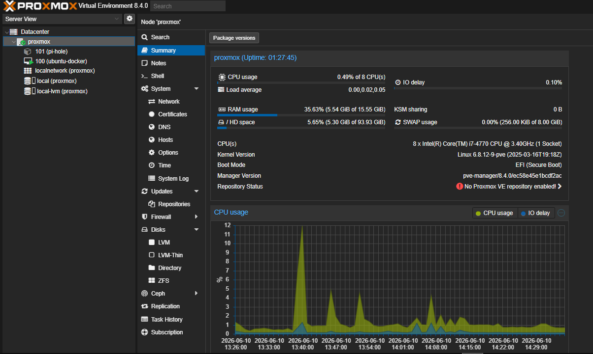
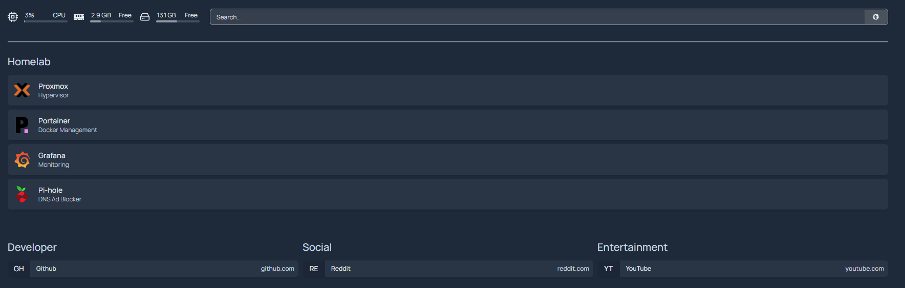
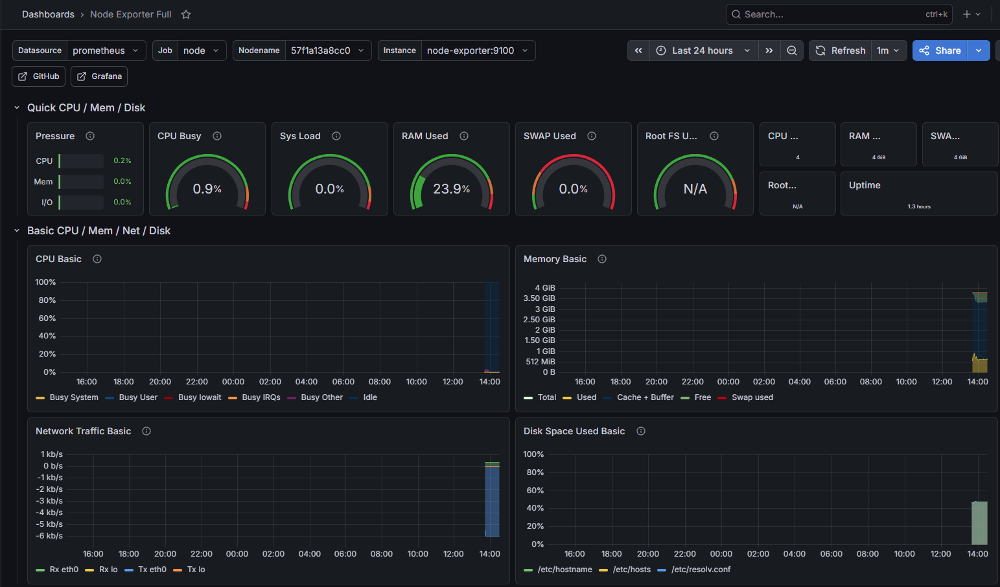
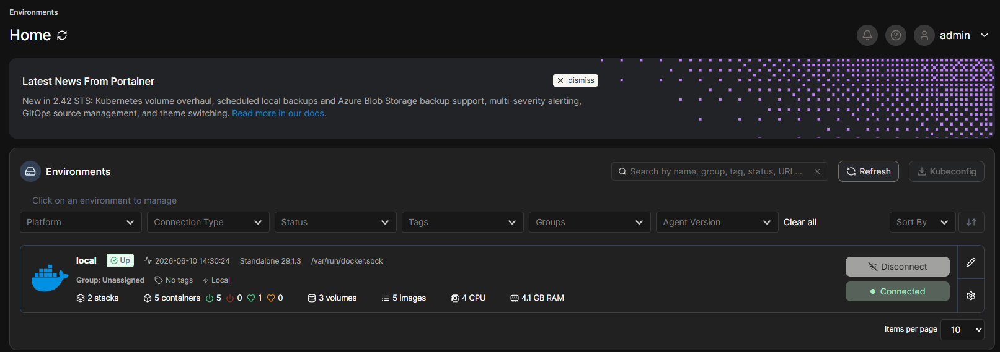
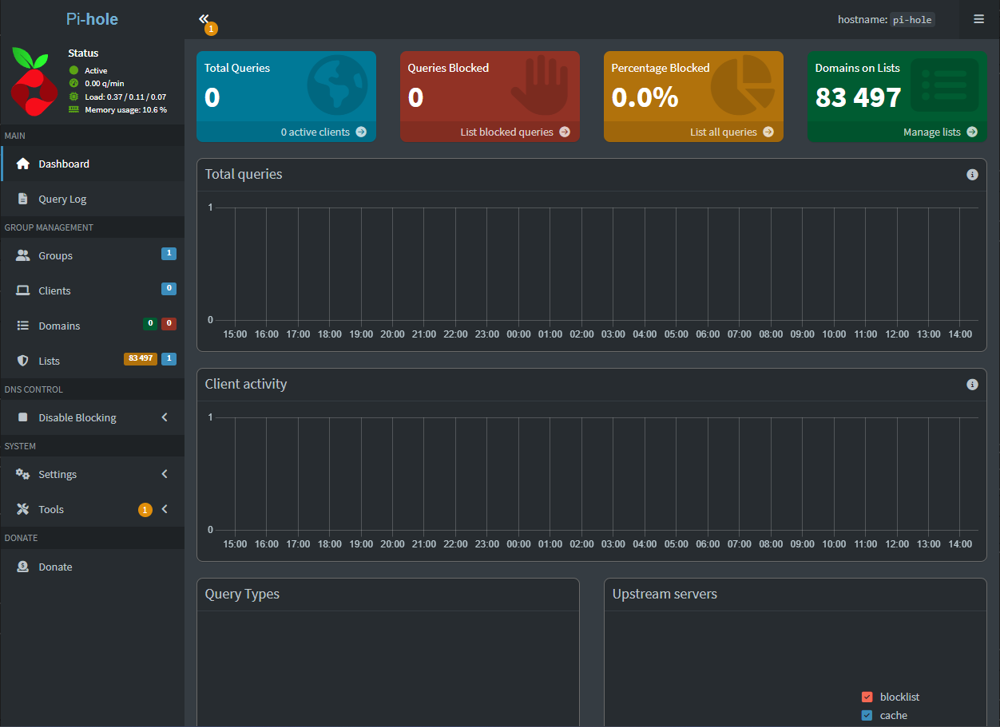

# Homelab Infrastructure

A personal homelab built on an old desktop PC using Proxmox VE. The environment is used to gain hands-on experience with IT infrastructure, virtualization, networking, Linux and Windows administration, cybersecurity, and DevOps.

The homelab includes containerized services, network monitoring, DNS filtering, remote access, and an isolated Windows Server Active Directory environment.

---

## Hardware

| Component | Specification |
|---|---|
| CPU | Intel Core i7-4770 |
| RAM | 16 GB DDR3 |
| GPU | NVIDIA GTX 950 (unused) |
| SSD | 512 GB (OS) |
| HDD | 1 TB (storage) |

---

## Infrastructure

### Proxmox VE

- **Type:** Type 1 hypervisor (bare metal)
- **Version:** 8.4.0
- **Management IP:** `192.168.10.200`
- **Web UI:** `https://192.168.10.200:8006`
- **Physical network interface:** `enp3s0`
- **Remote access:** Tailscale

Proxmox VE is the central virtualization platform hosting the virtual machines and LXC containers.

### Virtual Machines and Containers

| Machine | OS | Role | Local IP |
|---|---|---|---|
| Ubuntu Docker VM | Ubuntu Server 22.04 LTS | Docker host | `192.168.10.119` |
| Windows Server 2022 (DC01) | Windows Server 2022 | Active Directory, DNS and DHCP | `192.168.20.10` |
| Windows 11 (User01) | Windows 11 | Active Directory client | DHCP |
| OPNsense | OPNsense | Firewall and router | WAN: DHCP / LAN: `192.168.20.1` |
| Pi-hole LXC | Debian 12 | DNS filtering | `192.168.10.100` |

---

## Network Architecture

The homelab uses two separate virtual networks connected through an OPNsense virtual firewall.

### Network Overview

| Network | Subnet | Purpose |
|---|---|---|
| Home network | `192.168.10.0/24` | Proxmox management and existing services |
| Internal lab network | `192.168.20.0/24` | Windows Server and domain-joined clients |

### Network Topology

```text
                         INTERNET
                             |
                      Home Router
                       192.168.10.1
                             |
                       Home Network
                      192.168.10.0/24
                             |
                       Proxmox VE
                      192.168.10.200
                             |
                           vmbr0
                             |
                       OPNsense WAN
                         DHCP
                             |
                       OPNsense
                             |
                       OPNsense LAN
                       192.168.20.1
                             |
                           vmbr1
                             |
                    Internal Lab Network
                      192.168.20.0/24
                             |
                    +--------+--------+
                    |                 |
               Windows Server     Windows 11
                  DC01              User01
              192.168.20.10         DHCP
                    |
              Active Directory
                 DNS / DHCP
```

### Proxmox Network Bridges

**vmbr0 – Home network**

- Connected to the physical Ethernet interface `enp3s0`.
- Proxmox management IP: `192.168.10.200/24`.
- Default gateway: `192.168.10.1`.
- Hosts services and virtual machines connected to the home network.

**vmbr1 – Internal lab network**

- Internal Linux bridge with no physical network ports.
- No IP address assigned to the bridge itself.
- Connects internal lab virtual machines to the LAN interface of OPNsense.
- Uses the `192.168.20.0/24` subnet.

The two networks are connected through OPNsense. This provides a routed network boundary between the home network and the internal lab environment.

**Note:** This setup uses separate virtual bridges and subnets, not VLANs. VLAN configuration is a potential future improvement.

### OPNsense

OPNsense runs as a virtual firewall and router inside Proxmox.

| Interface | Bridge | Address |
|---|---|---|
| WAN | vmbr0 | DHCP from home router |
| LAN | vmbr1 | `192.168.20.1/24` |

Responsibilities:

- Routing between the internal lab network and external networks.
- Outbound internet connectivity for lab machines.
- Network traffic filtering through firewall rules.
- Outbound NAT.

The OPNsense DHCP service is disabled on LAN because Windows Server 2022 provides DHCP for the internal lab network.

---

## Services

### Ubuntu Docker VM

| Setting | Value |
|---|---|
| OS | Ubuntu Server 22.04 LTS |
| vCPUs | 4 |
| RAM | 4 GB |
| Disk | 50 GB |
| Local IP | `192.168.10.119` |
| Role | Main Docker host |

The Ubuntu VM hosts several self-hosted services using Docker and Docker Compose.

### Docker Services

| Service | Local URL | Description |
|---|---|---|
| Portainer | `http://192.168.10.119:9000` | Docker management |
| Grafana | `http://192.168.10.119:3000` | Monitoring dashboards |
| Prometheus | `http://192.168.10.119:9090` | Metrics collection |
| Homepage | `http://192.168.10.119:3001` | Service dashboard |

### Pi-hole and Unbound

Pi-hole runs as an LXC container on Proxmox.

| Setting | Value |
|---|---|
| OS | Debian 12 |
| vCPUs | 1 |
| RAM | 512 MB |
| Disk | 4 GB |
| Local IP | `192.168.10.100` |
| Web interface | `http://192.168.10.100/admin` |

Pi-hole provides network-wide DNS filtering and ad blocking for the home network.

It uses **Unbound** as a local recursive DNS resolver instead of relying on an external public DNS resolver.

Configuration file:

[`pi-hole/unbound/pi-hole.conf`](pi-hole/unbound/pi-hole.conf)

**DNS note:** The internal Active Directory network uses Windows Server DNS (`192.168.20.10`). Pi-hole remains a separate DNS service on the home network.

---

## Remote Access

Tailscale is installed on:

- Proxmox VE host
- Ubuntu Docker VM
- Pi-hole LXC container

Tailscale provides secure remote access to the homelab without requiring conventional port forwarding or exposing management services directly to the public internet.

Remote Tailscale IP addresses are intentionally represented as placeholders in this documentation.

---

## Screenshots

### Proxmox — Hypervisor


### Homepage — Service Dashboard


### Grafana — Monitoring Dashboard


### Portainer — Docker Management


### Pi-hole — DNS Ad Blocker


---

## Repository Structure

```text
homelab/
├── README.md
├── screenshots/
├── monitoring/
│   ├── docker-compose.yml
│   └── prometheus.yml
├── homepage/
│   ├── docker-compose.yml
│   └── config/
│       └── services.yaml
├── pi-hole/
│   └── unbound/
│       └── pi-hole.conf
└── active-directory/
    ├── README.md
    └── screenshots/
```
