# Active Directory Homelab

## Overview

This project documents a Windows Server 2022 Active Directory environment running on Proxmox VE.

The lab simulates a small business IT environment and is used to gain practical experience with Windows Server administration, identity management, DNS, DHCP, Group Policy and network administration.

The environment runs on a dedicated internal network, separated from the home network using a virtual firewall and router (OPNsense).

## Objectives

- Deploy Windows Server 2022 as a Domain Controller.
- Install and configure Active Directory Domain Services (AD DS).
- Create and manage an Active Directory domain.
- Configure DNS for internal domain resolution.
- Configure DHCP for automatic client IP assignment.
- Create Organizational Units (OUs).
- Create domain users and security groups.
- Assign users to groups based on organizational roles.
- Join Windows 11 clients to the domain.
- Verify domain connectivity and secure channel functionality.
- Implement and test Group Policy Objects (GPOs).

---

## Lab Environment

| Machine | Role | IP Address | Operating System |
|---|---|---|---|
| DC01 | Domain Controller, DNS and DHCP | `192.168.20.10` | Windows Server 2022 |
| User01 | Domain-joined client | DHCP (`192.168.20.100–200`) | Windows 11 |
| OPNsense | Firewall and default gateway | `192.168.20.1` (LAN) | OPNsense |

**Domain:**

```text
homelab.local
```

### Network Configuration

The Active Directory environment runs on a separate internal network behind OPNsense.

| Setting | Value |
|---|---|
| Internal subnet | `192.168.20.0/24` |
| Default gateway | `192.168.20.1` |
| Domain Controller | `192.168.20.10` |
| DNS server | `192.168.20.10` |
| DHCP server | `192.168.20.10` |
| DHCP address range | `192.168.20.100–192.168.20.200` |

The internal network uses a dedicated Proxmox Linux bridge (`vmbr1`), with OPNsense providing routing and internet connectivity.

Windows Server 2022 provides DNS and DHCP services for the internal network. The OPNsense DHCP service is disabled on the LAN interface to avoid competing DHCP servers.

### Network Topology

```text
                  Home Network
                  192.168.10.0/24
                         |
                      vmbr0
                         |
                   OPNsense WAN
                         |
                     OPNsense
                         |
                   OPNsense LAN
                    192.168.20.1
                         |
                      vmbr1
                         |
                Internal Lab Network
                  192.168.20.0/24
                         |
                 +-------+-------+
                 |               |
                DC01           User01
          Windows Server 2022  Windows 11
            192.168.20.10       DHCP
                 |
          Active Directory
             DNS / DHCP
```

---

## Active Directory Structure

The domain is organized using Organizational Units to separate users, administrators, groups, computers and servers.

```text
homelab.local
│
├── OU_Users
│   ├── Chris Olsen
│   ├── Ola Hansen
│   └── Kari Nordmann
│
├── OU_Admins
│   └── Chris Admin
│
├── OU_Groups
│   ├── IT_Users
│   ├── HR_Users
│   ├── Sales_Users
│   ├── IT_Admins
│   └── Servers_Users
│
├── OU_Computers
│   └── User01
│
└── OU_Servers
    └── DC01
```

## Users

| Name | Username | Role |
|---|---|---|
| Chris Olsen | `chris.it` | IT user |
| Ola Hansen | `ola.hr` | HR user |
| Kari Nordmann | `kari.sales` | Sales user |
| Chris Admin | `cadmin` | Administrative account |

## Security Groups

| Group | Purpose |
|---|---|
| IT_Users | Standard IT users |
| HR_Users | HR department users |
| Sales_Users | Sales department users |
| IT_Admins | IT administrator accounts |
| Servers_Users | Server-related access testing |

## Group Memberships

| User | Security Group |
|---|---|
| `chris.it` | IT_Users |
| `ola.hr` | HR_Users |
| `kari.sales` | Sales_Users |
| `cadmin` | IT_Admins |

---

## Windows Server Services

### Active Directory Domain Services (AD DS)

Windows Server 2022 operates as the Domain Controller for `homelab.local`.

AD DS provides centralized identity and access management, allowing domain users and computers to authenticate against the domain.

### DNS

The Windows Server also hosts DNS for the Active Directory domain.

| Setting | Value |
|---|---|
| DNS server IP | `192.168.20.10` |
| Internal domain | `homelab.local` |
| Client DNS | `192.168.20.10` |

Domain-joined clients use the Domain Controller as their DNS server to locate Active Directory services and resolve internal domain names.

### DHCP

Windows Server 2022 provides automatic IP configuration to clients on the internal lab network.

**DHCP Scope: Homelab-LAN**

| Setting | Value |
|---|---|
| Network | `192.168.20.0/24` |
| Start IP | `192.168.20.100` |
| End IP | `192.168.20.200` |
| Subnet mask | `255.255.255.0` |
| Default gateway (Option 003) | `192.168.20.1` |
| DNS server (Option 006) | `192.168.20.10` |
| DNS domain (Option 015) | `homelab.local` |

The DHCP scope is configured and activated on Windows Server. OPNsense DHCP is disabled on the internal LAN to ensure that Windows Server is the only DHCP server for this network.

---

## Windows 11 Domain Client

Windows 11 is configured as a domain-joined workstation.

| Setting | Configuration |
|---|---|
| Computer name | User01 |
| Operating system | Windows 11 |
| Network | `192.168.20.0/24` |
| IP configuration | Automatic (DHCP) |
| DNS configuration | Automatic (DHCP) |
| Domain | `homelab.local` |

The client receives its IP address, default gateway and DNS server automatically from Windows Server 2022.

---

## Verification and Testing

The following tests were performed to verify network connectivity and Active Directory functionality.

### 1. Network Connectivity

```cmd
ping 192.168.20.1
ping 1.1.1.1
```

**Result:** Successful.

Verified connectivity to the OPNsense LAN gateway and outbound internet connectivity.

### 2. External DNS Resolution

```cmd
nslookup google.com
```

**Result:** Successful.

Verified external DNS resolution from the Windows 11 client.

### 3. DHCP Address Assignment

```cmd
ipconfig /release
ipconfig /renew
ipconfig /all
```

**Result:** Successful.

Verified that the Windows 11 client receives its network configuration automatically from Windows Server 2022.

### 4. Active Directory Domain Discovery

```cmd
nltest /dsgetdc:homelab.local
```

**Result:** Successful.

Verified that the client can locate the Active Directory Domain Controller.

### 5. Internal DNS Resolution

```cmd
nslookup homelab.local
```

**Result:** Successful.

Verified DNS resolution for the internal Active Directory domain.

### 6. Secure Channel Verification

```powershell
Test-ComputerSecureChannel -Verbose
```

**Result:** `True`.

Verified that the Windows 11 client maintains a functioning secure channel with the Active Directory domain.

---

## Screenshots

Screenshots are included to document the implementation and verify the configuration.

### Proxmox – Windows Server 2022 VM (DC01)

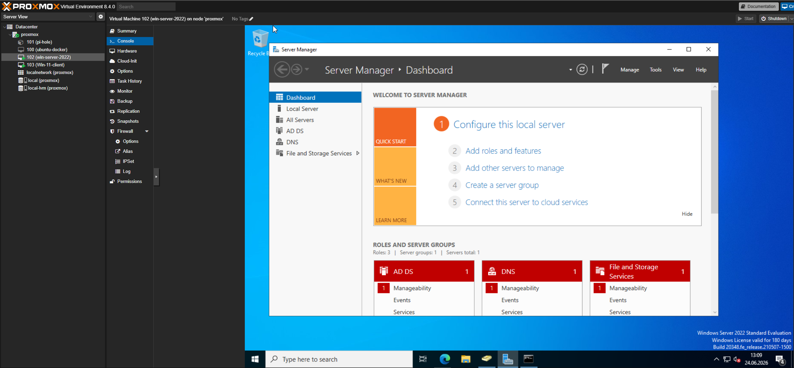

### AD DS Installation

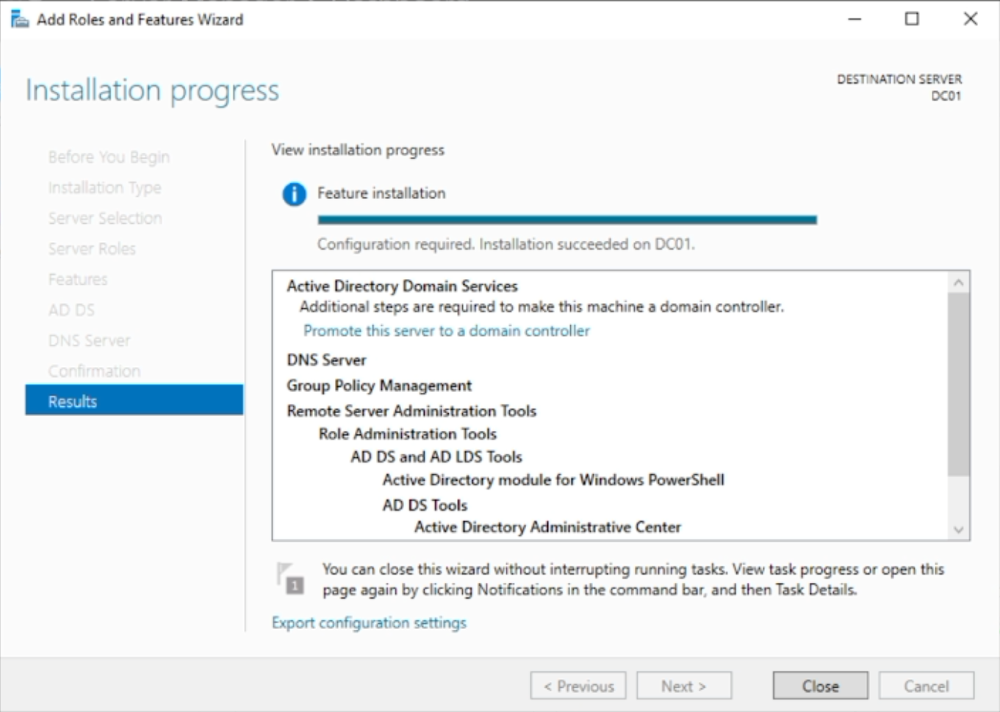

### Domain Creation (homelab.local)

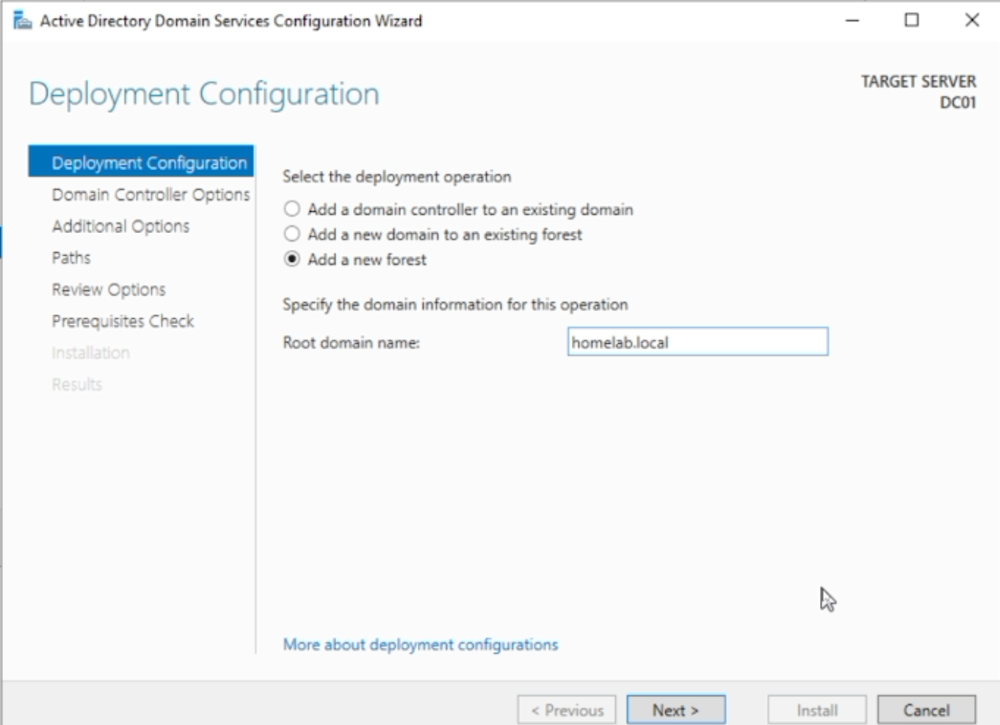

### DC01 IP Configuration

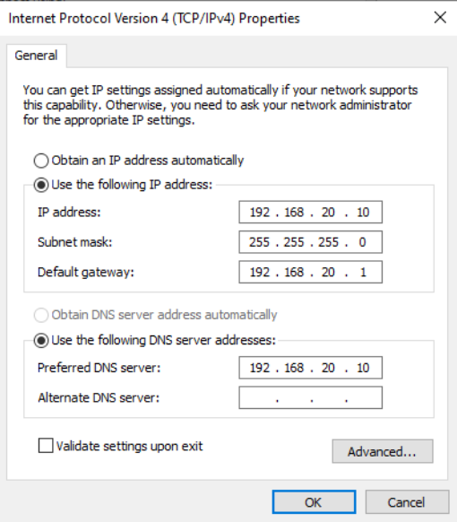

### DNS Confirmation

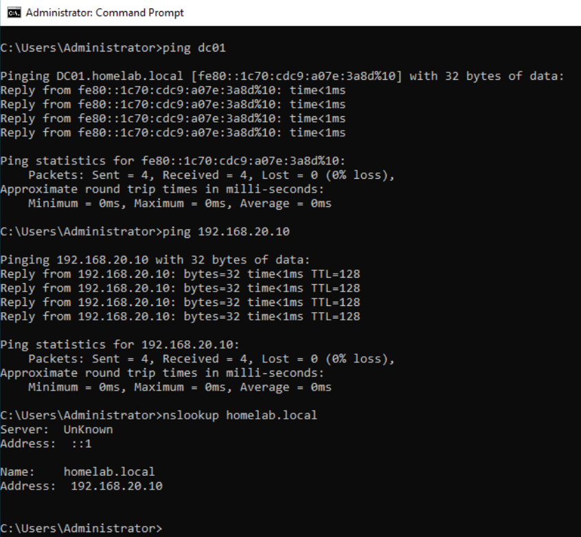

### Domain Join

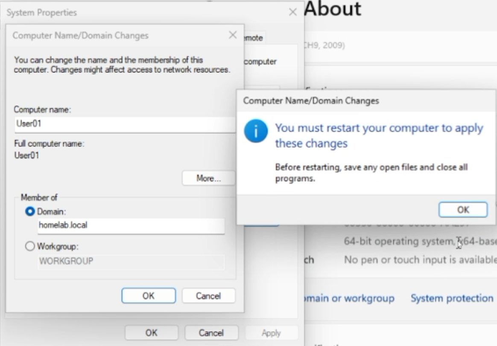

### OU Structure and Security Groups

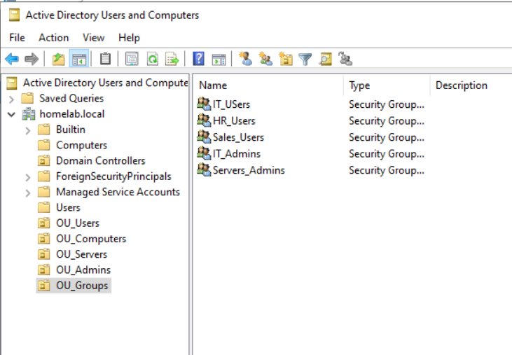

### Domain User Login

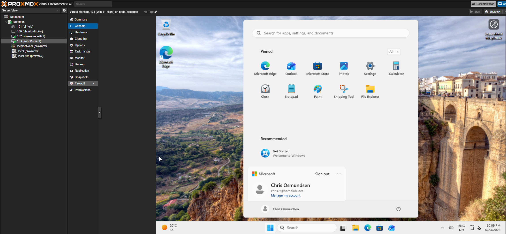

### DHCP Scope and Configuration

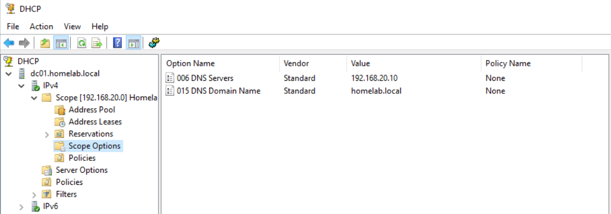

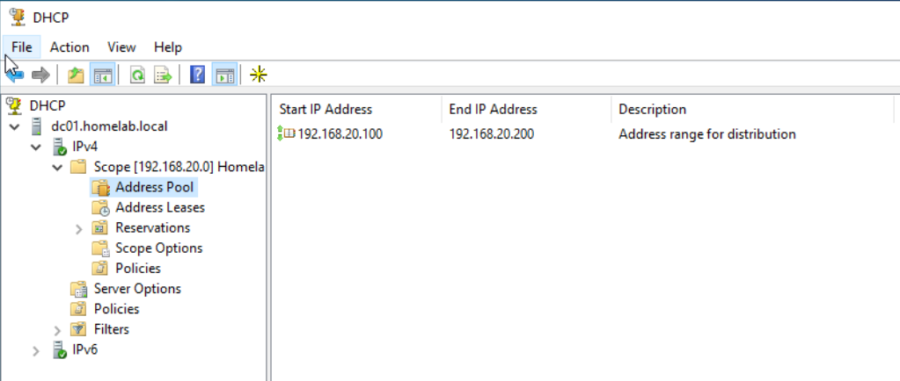

### OPNsense Network Interfaces

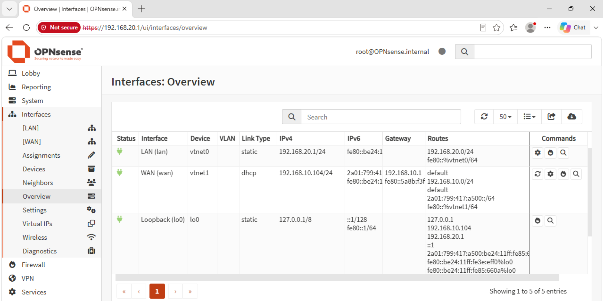

### DHCP Client Configuration

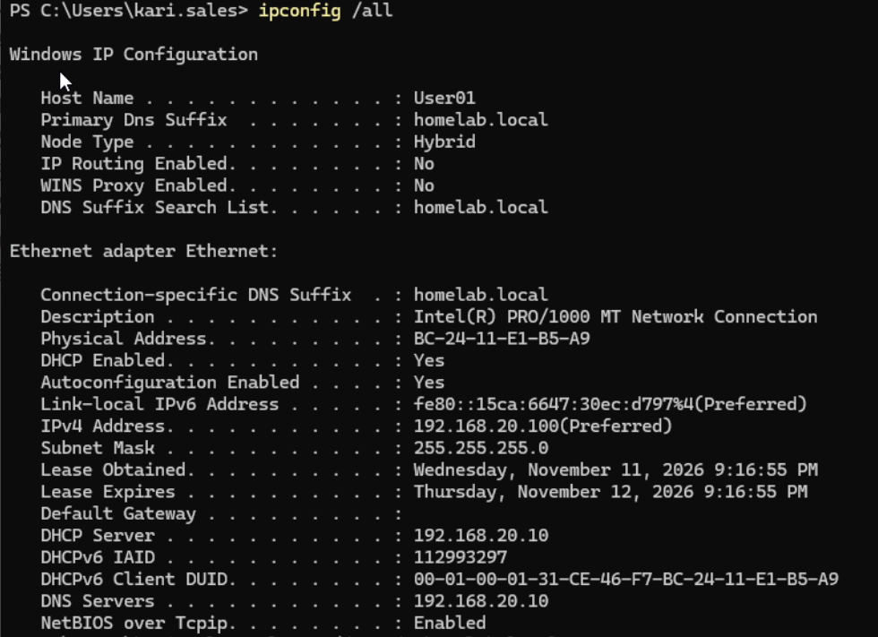

### Active Directory Connectivity Tests

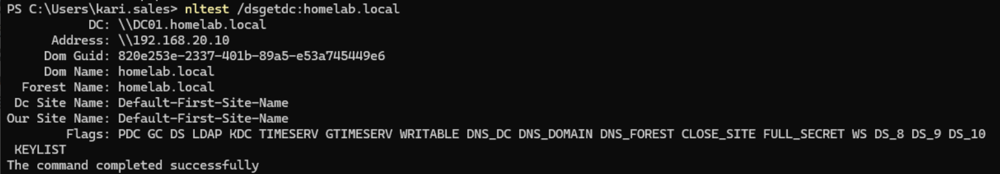

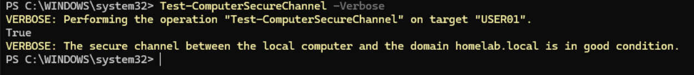

---

## Tools Used

- Proxmox VE
- OPNsense
- Windows Server 2022
- Windows 11
- Active Directory Domain Services
- Active Directory Users and Computers
- DNS Manager
- DHCP Manager
- Group Policy Management
- PowerShell
- Command Prompt

---

## Skills Demonstrated

- Windows Server 2022 administration.
- Active Directory Domain Services deployment and management.
- Domain controller configuration.
- Organizational Unit and security group management.
- DNS configuration and troubleshooting.
- DHCP scope creation and configuration.
- Windows domain joining and authentication.
- PowerShell-based administration and troubleshooting.
- Network configuration and subnetting.
- Virtualized network infrastructure using Proxmox VE and OPNsense.

**Project status:** Active Directory, DNS, DHCP and Windows 11 domain connectivity are operational. Further security hardening and Group Policy configuration are planned.
